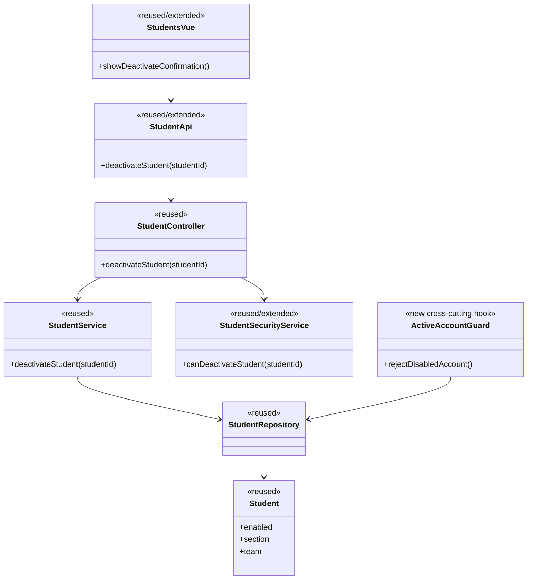
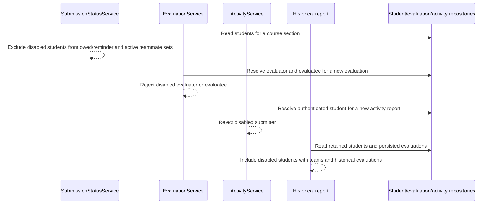

# Student Design

> Realizes: UC-STU-deactivate-student
> Depends on: FR-SEC-authentication, FR-SEC-authorization, FR-SEC-deny-unauthorized, FR-SEC-active-account, BR-student-lifecycle, SEC-authorization, SEC-ferpa
> See: [Use Cases](../requirements/use-cases.md), [Software Requirements Specification](../requirements/software-requirements-specification.md), [Business Rules](../requirements/business-rules.md), [architecture-of-record](architectural-design.md)

## Overview

Student lifecycle management extends the existing student vertical slice with an explicit deactivation command. Deactivation is logical: it changes the existing `Student.enabled` state, preserves the course-section/team associations and submitted records, and relies on the shared security model to deny both new and already-issued access. The student bounded context remains in the shared foundation described by the architecture-of-record; no Level-1 boundary changes.

## Components & classes



- **Reused:** `Student`, `StudentRepository`, DTO/converter conventions, `StudentController`, `StudentService`, `StudentSecurityService`, `Students.vue`, and the shared `Result` envelope.
- **New or extended:** a dedicated lifecycle endpoint/service method, scoped authorization for course-admin ownership or assigned-instructor membership, a student API call and confirmation interaction, and request-time active-account enforcement for already-issued JWTs.
- **Related existing behavior:** `SubmissionStatusService.findOwedItems` already filters inactive students from owed-submission and active-teammate sets under `BR-submission-owed`; `EvaluationService.generateWeeklyPeerEvaluationReportForSection` must retain its current team-based inclusion so historical rows remain visible under `BR-student-lifecycle`.

## Sequence

### Deactivate an active student

```mermaid
sequenceDiagram
    actor A as Course admin / assigned instructor
    participant UI as Students UI
    participant C as StudentController
    participant Z as Lifecycle authorization
    participant S as StudentService
    participant R as StudentRepository

    A->>UI: Choose Deactivate (UC steps 1-3)
    UI-->>A: Show retained-work/access warning (step 4)
    A->>UI: Confirm (step 5)
    UI->>C: POST /api/v1/students/{studentId}/deactivate
    C->>Z: Apply SecurityConfiguration POST students/{studentId}/deactivate rule
    Z->>Z: Check active actor, course ownership, or section assignment
    Z-->>C: Permit
    C->>S: deactivateStudent(studentId)
    S->>R: Load active student in permitted scope
    R-->>S: Student
    S->>S: Set enabled=false; retain associations and records
    S->>R: Save atomically
    R-->>C: Deactivated student
    C-->>UI: Success Result
    UI-->>A: Student deactivated alert (step 6)
```

### Effects on future work and historical reporting



### Account access state

```mermaid
stateDiagram-v2
    [*] --> Active
    Active --> Active: Cancel before confirmation
    Active --> Deactivated: Confirm; persist enabled=false
    Deactivated --> Deactivated: Reject repeat deactivation
    Deactivated --> Active: UC-STU-reactivate-student
```



## API contract

| Endpoint or job | Caller (who may) | Request | Success | Errors, by extension |
|---|---|---|---|---|
| `POST /api/v1/students/{studentId}/deactivate` | Active course admin owning the course containing the student's course section; active instructor assigned to the student's course section | Path student id; no mutable profile fields | Standard `Result` containing the `StudentDto` with `enabled=false` | `403` for an unauthenticated/unauthorized role, unknown target, or out-of-scope target (fail closed without an existence oracle); invalid-state response when already deactivated |
| Existing protected-resource request | Authenticated caller with an existing JWT | Existing bearer token | Normal protected-resource response only for an active account | Authentication/access denial when the token names a deactivated account |

## Key decisions

- **Dedicated lifecycle command.** Use a deactivation endpoint and service method instead of accepting `enabled=false` through generic profile editing. The generic update path was rejected because it combines unrelated profile mutation with a security-sensitive lifecycle transition and cannot express the confirmation or already-deactivated error cleanly.
- **Exact scoped authorization.** Permit a course admin only within an owned course and an instructor only within the student's course section. Role-only or self-only authorization was rejected because it does not enforce `BR-student-lifecycle` and `FR-SEC-authorization`.
- **SecurityConfiguration route rule.** Register the command as `.requestMatchers(HttpMethod.POST, this.baseUrl + "/students/{studentId}/deactivate").access(this.studentLifecycleAuthorizationManager)` in `SecurityConfiguration`, with the manager enforcing the `BR-student-lifecycle` scope; a generic `authenticated()` or existing `userOwnershipAuthorizationManager` rule was rejected because neither expresses course ownership versus assigned-section authority.
- **Active actor and command-time scope.** The lifecycle command checks the caller's active account and resolves the target scope again on the server after confirmation. Trusting the previously displayed student or permitting a disabled actor was rejected because protected-resource authorization is server-side and must fail closed.
- **Fail-closed target errors.** Unknown and out-of-scope student ids are denied without revealing whether a row exists. A `404` existence oracle was rejected in favor of the architecture's authorization-manager behavior.
- **Immediate account enforcement.** Check persisted account state on protected requests, not only at the next login. A login-only check was rejected because `FR-SEC-active-account` explicitly covers otherwise-valid credentials and already-issued JWTs.
- **Logical retention.** Preserve the `Student` row, course-section/team associations, weekly activity reports, and peer evaluations. Physical deletion or team removal was rejected because deactivation is recoverable and historical reporting must continue to show retained work.
- **Active-submission invariant.** `ActivityService.saveActivity` rejects a disabled submitter, and `EvaluationService.addPeerEvaluation` rejects a disabled evaluator or evaluatee, as required by `BR-student-lifecycle` and `BR-team-assignment-required`. Relying only on the browser or JWT guard was rejected because service-level invariants also protect scheduled, direct, and future API paths.
- **Historical-report invariant.** `EvaluationService.generateWeeklyPeerEvaluationReportForSection` continues to include students with teams regardless of current `enabled` state, and authorized historical activity/evaluation queries retain persisted rows, as required by `BR-student-lifecycle`. Filtering disabled students from reports was rejected because it would erase the historical identity of submitted evaluations.
- **Existing-record boundary.** Deactivation blocks new student submissions and new evaluations addressed to the disabled student, while `SubmissionStatusService.findOwedItems` excludes the disabled student from future owed work and teammate requirements. It does not delete or hide historical rows from authorized instructor/course-admin reports. Existing evaluation edits remain governed by their existing submission-window and ownership rules rather than being redefined by this use case.
- **Actor-only feedback.** The confirmation warning and success alert are shown to the actor; no deactivation email or persistent student notification is sent. A new notification flow was rejected because this use case specifies actor feedback and does not require student notification.

## Data model

There is no data-model delta or migration. The existing `Student.enabled` field is the lifecycle state; the existing `section`, `team`, activity, and peer-evaluation relationships remain unchanged. The shared domain model is defined by the SRS [Business Domain Model](../requirements/software-requirements-specification.md#business-domain-model).

## Reuse & cross-cutting

- **Authorization:** extend the existing route-manager plus scoped service pattern in `security/` and `student/`; enforce both route permission and target scope.
- **Active account:** reuse the persisted `enabled` flag and JWT identity, adding request-time account-state enforcement so existing tokens lose access.
- **Reminders:** reuse `SubmissionStatusService.findOwedItems`; inactive students remain excluded from both reminder recipients and active teammate evaluation sets.
- **Submission rules:** add active-account checks to `ActivityService.saveActivity` and `EvaluationService.addPeerEvaluation`.
- **Historical data:** reuse existing activity/evaluation repositories and report aggregation without an enabled-state filter for authorized instructor/course-admin reports.
- **Notification policy:** no email or persistent student notification is added.

## Tests

| Use case, flow | Level (unit / integration) | Concrete test target and assertion |
|---|---|---|
| Main success | `StudentServiceTest.deactivateStudentDisablesActiveStudent` and `StudentIntegrationTest.courseAdminDeactivatesStudent` | Authorized actor deactivates an active student; `enabled=false`; section/team associations and historical activity/evaluation rows remain |
| Course-admin scope | `StudentIntegrationTest.courseAdminDeactivatesStudent` and `StudentIntegrationTest.unrelatedCourseAdminCannotDeactivateStudent` | Owning course admin succeeds; unrelated course admin is denied |
| Assigned-instructor scope | `StudentIntegrationTest.assignedInstructorDeactivatesStudent` and `StudentIntegrationTest.unassignedInstructorCannotDeactivateStudent` | Instructor assigned to the student's course section succeeds; instructor assigned elsewhere is denied |
| Cancellation before confirmation | `frontend/src/views/instructor/__tests__/Students.spec.ts::cancelsDeactivationWithoutCallingApi` | Dismissal makes no API call, changes no state, and shows no success alert |
| Already deactivated | `StudentServiceTest.deactivateStudentRejectsAlreadyDeactivatedStudent` and `StudentIntegrationTest.alreadyDeactivatedStudentIsRejected` | Operation is rejected with an explanatory error and state remains unchanged |
| No future submission reminders | `SubmissionStatusServiceTest.findOwedItemsExcludesDisabledStudent` and `SubmissionStatusServiceIntegrationTest.disabledStudentIsAbsentFromOwedItems` | Disabled student is absent from scheduled and on-demand owed-submission results for both weekly items |
| No future teammate rating request | `SubmissionStatusServiceTest.peerEvaluationOwedExcludesDisabledTeammate` and `SubmissionStatusServiceIntegrationTest.testAnEvaluationOfADeactivatedTeammateIsNotRequired` | Active teammates are not required or prompted to evaluate the disabled student |
| Historical reports and evaluations remain visible | `EvaluationServiceTest.testGenerateWeeklyPeerEvaluationReportIncludesDisabledStudentHistory` and `EvaluationIntegrationTest.adminCanReadDisabledStudentHistoricalEvaluations` | Authorized instructor/course-admin section reports include the retained student and persisted evaluations for prior weeks; deactivation does not erase historical rows |
| Disabled student cannot add new peer evaluations | `EvaluationServiceTest.addPeerEvaluationRejectsDisabledEvaluator` and `EvaluationIntegrationTest.disabledStudentCannotAddPeerEvaluation` | New evaluation is rejected when the disabled student is evaluator or evaluatee |
| Disabled student cannot submit weekly activity report | `ActivityServiceTest.testSaveActivityRejectsDisabledSubmitter` and `ActivityIntegrationTest.disabledStudentCannotAddActivity` | New activity report is rejected for a disabled caller |
| Existing JWT access | `AuthorizationRuleIntegrationTest.disabledStudentTokenIsRejectedAfterDeactivation` | A token issued before deactivation cannot access protected resources afterward |
| New login | `UserIntegrationTest.disabledStudentCannotLogin` | A disabled student cannot authenticate |

## Open questions / risks

- The current stateless JWT resource-server path derives authorities from token claims; the request-time active-account guard must run after token authentication and before protected application work.
- The active-account guard must not bypass the deactivation command for a disabled student; only an already-authorized active course admin or assigned instructor may invoke it.
- Existing generic student update and route authorization paths predate this lifecycle use case. They must not remain an alternate way to change lifecycle state without the same scope and active-state invariants.
- The current report method already uses team membership rather than `enabled` as its inclusion predicate; a regression test is required to prevent a future “active students only” optimization from removing historical rows.
- Reminder recipients are computed at send time; this design guarantees that no new reminder includes a disabled student after deactivation commits, not recall of an email already accepted by SMTP.
